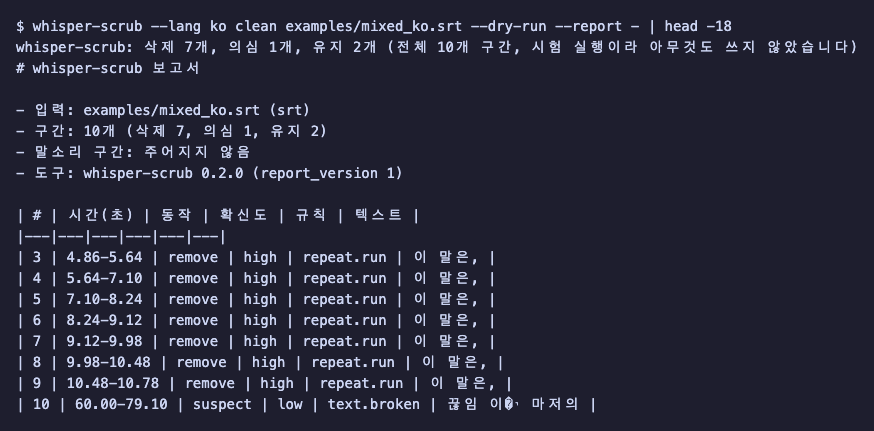
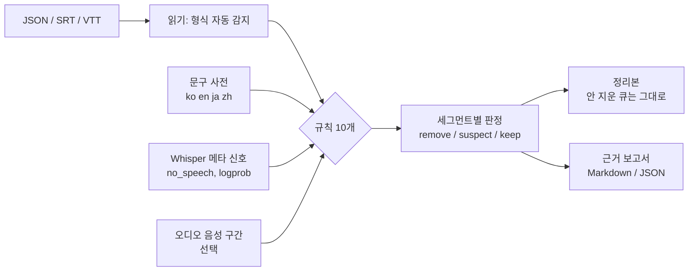
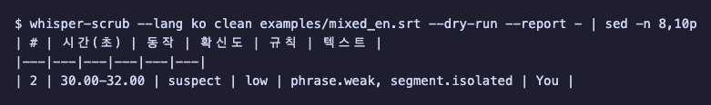
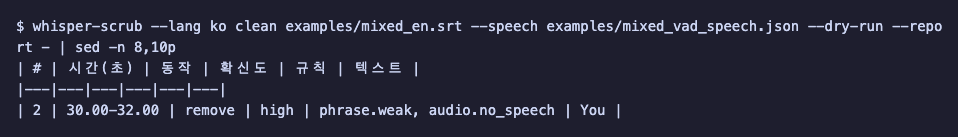
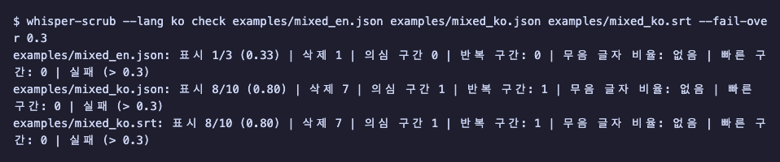

# whisper-scrub

[English](README.md) | **한국어**

Whisper(openai-whisper, faster-whisper, whisper.cpp, OpenAI API)가 만든 전사·자막에서 **무음·잡음 구간에 생긴 가짜 문장**과 **같은 말이 되풀이되는 루프**를 찾아 지웁니다. 타임코드와 번호는 그대로 두고, **왜 지웠는지**를 세그먼트마다 보고서로 남깁니다. 정답 전사가 없어도 파일의 환각 의심 비율을 점검(`check`)할 수 있습니다.

## 무엇을 해 주나

받아쓰기 담당자가 방이 조용해질 때마다 "시청해 주셔서 감사합니다"를 적어 넣는다고 상상해 보세요. Whisper 가 무음·잡음 구간에서 하는 일이 이와 비슷합니다. 이 저장소의 `tiny` 모델 재현 실행에서 실제로 나온 문장입니다(무음·잡음·단순 톤 입력).

| 언어 | 입력 | 나온 문장 |
|---|---|---|
| ko | 무음·잡음·톤 | `수고하셨습니다` |
| ja | 무음 | `ご視聴ありがとうございました` |
| en | 무음 | `You` |

## 설치

```bash
pip install "whisper-scrub[audio]"
```

- Python 3.10 이상. 기본 설치는 런타임 의존성이 0개입니다. `[audio]` extra 는 numpy 하나만 추가하며, 오디오 파일(`--audio`)을 직접 읽을 때만 필요합니다. 음성 구간 JSON(`--speech`)이나 메타 신호만 쓸 거라면 `pip install whisper-scrub` 으로 충분합니다.
- uv 를 쓰면: `uv add "whisper-scrub[audio]"` 또는 설치 없이 `uvx whisper-scrub --help`. (uv 설치: `curl -LsSf https://astral.sh/uv/install.sh | sh`)
- 소스에서 설치: `pip install "git+https://github.com/LeeGyeongPil/whisper-scrub"`
- 깨끗한 환경에서 휠을 `[audio]` 와 함께 설치해 아래 예제가 돌아가는 것을 확인했습니다(Python 3.12, numpy 2.5.4).

## 빠르게 시작하기

이 저장소의 `examples/` 에는 faster-whisper 1.2.1 `tiny` 모델이 실제로 낸 결과를 녹화한 파일이 있습니다. **연습용 목(mock) 입력**입니다: 모델이 돌지 않고 저장된 결과만 읽습니다. 직접 만든 전사에서도 같은 방식으로 돌아갑니다.

uv 가 필요합니다(설치 절 참고). uv 없이 쓰려면 `python -m venv .venv && .venv/bin/pip install -e ".[audio]"` 후 `uv run` 을 빼고 `.venv/bin/whisper-scrub` 로 실행합니다.

```bash
git clone https://github.com/LeeGyeongPil/whisper-scrub
cd whisper-scrub
uv sync
uv run whisper-scrub --lang ko clean examples/mixed_ko.srt --dry-run --report -
```

`--dry-run` 은 판정만 하고 파일을 쓰지 않습니다. `--report -` 는 보고서를 화면에 찍습니다. 영어 음성에 한국어(`language="ko"`)를 강제해 생긴 "이 말은," 8연속 루프가 이렇게 잡힙니다.



*그림 1. 3~9번 큐가 `repeat.run` 규칙으로 `remove`(첫 번째 "이 말은,"만 남김). 10번은 깨진 글자(U+FFFD)가 있어 `suspect`.*

실제 출력(표 부분, `--lang ko` 화면. 규칙 ID, `remove`·`suspect`·`keep` 값, `high`·`low` 값, 규칙별 근거 설명은 설계상 영어 그대로입니다):

```text
whisper-scrub: 삭제 7개, 의심 1개, 유지 2개 (전체 10개 구간, 시험 실행이라 아무것도 쓰지 않았습니다)
# whisper-scrub 보고서

- 입력: examples/mixed_ko.srt (srt)
- 구간: 10개 (삭제 7, 의심 1, 유지 2)
- 말소리 구간: 주어지지 않음
- 도구: whisper-scrub 0.2.0 (report_version 1)

| # | 시간(초) | 동작 | 확신도 | 규칙 | 텍스트 |
|---|---|---|---|---|---|
| 3 | 4.86-5.64 | remove | high | repeat.run | 이 말은, |
| 4 | 5.64-7.10 | remove | high | repeat.run | 이 말은, |
| 5 | 7.10-8.24 | remove | high | repeat.run | 이 말은, |
| 6 | 8.24-9.12 | remove | high | repeat.run | 이 말은, |
| 7 | 9.12-9.98 | remove | high | repeat.run | 이 말은, |
| 8 | 9.98-10.48 | remove | high | repeat.run | 이 말은, |
| 9 | 10.48-10.78 | remove | high | repeat.run | 이 말은, |
| 10 | 60.00-79.10 | suspect | low | text.broken | 끊임 이�י 마저의 |
```

보고서 아래쪽 `## 근거` 절에 규칙마다 근거가 한 줄씩 나옵니다. 예:

```text
- #3 remove: `repeat.run` 값=copy 2 of 8 기준=>= 3 in a row - same sentence as the previous segment; the first of 8 copies is kept
```

실제로 정리본을 쓰려면 `--dry-run` 대신 `-o`:

```bash
uv run whisper-scrub --lang ko clean examples/mixed_ko.srt -o ko.clean.srt
```

```text
whisper-scrub: 삭제 7개, 의심 1개, 유지 2개 (전체 10개 구간, ko.clean.srt 파일을 썼습니다)
```

원본과 정리본의 차이는 3~9번 큐 블록이 통째로 빠진 것뿐입니다. 1·2·10번 블록은 바이트 단위로 같고 번호는 원래대로(1, 2, 10) 남습니다(`--renumber` 를 주면 1, 2, 3).

```text
9,36d8
< 3
< 00:00:04,860 --> 00:00:05,640
< 이 말은,
< 
< 4
< 00:00:05,640 --> 00:00:07,100
< 이 말은,
(…5~9번 큐도 같은 모양…)
```

## 핵심 개념



1. **한 신호로 지우지 않고 조합합니다.** `remove` 는 (a) 혼자서 충분한 규칙(`phrase.strict`, `repeat.run`, `meta.silent_window` 등)이거나 (b) 약한 문구 일치(`phrase.weak`)에 "말소리가 없다"는 근거(`meta.no_speech`·`audio.no_speech`)가 하나 더 붙을 때입니다. 근거가 모자라면 `suspect`(의심, 지우지 않음)로 남깁니다. 말소리가 있다는 반대 증거가 있으면 `keep` 입니다.
2. **메타 신호는 30초 창 단위입니다.** Whisper 의 `no_speech_prob`·`avg_logprob`·압축률은 세그먼트가 아니라 디코딩 창마다 계산됩니다. 같은 창 안의 세그먼트들은 값이 같아서 메타만으로는 구분할 수 없습니다. 위 한국어 예에서 9개 세그먼트가 같은 값(no_speech 0.093, logprob -1.475, 압축률 2.222)을 공유했습니다. 그래서 문장 반복 자체를 보는 `repeat.run` 이 필요합니다. 보고서의 "같은 메타 값" 절(영어 화면에서는 "Shared meta values")에 이런 묶음이 표시됩니다.
3. **Whisper 자체 건너뛰기 규칙은 구멍이 있습니다.** Whisper 는 `no_speech_prob > 0.6` **그리고** `avg_logprob` 가 `-1.0` 이하일 때만 무음으로 보고 건너뜁니다. 이 저장소의 녹화에서 무음 20초가 `" You"` 로 나왔는데 값은 no_speech 0.985, logprob -0.942 로 두 번째 조건에서 빠져나갔습니다.
4. **`suspect` 와 `remove` 는 다릅니다.** 문구가 같아도 실제 말일 수 있어서(회의 끝의 "Thank you.") 확실한 근거가 있을 때만 지웁니다.

### 규칙 표

| 규칙 ID | 보는 것 | 혼자 삭제? | 오탐 위험 |
|---|---|---|---|
| `phrase.strict` | 정규화한 전체 문장이 사전의 확실한 환각 문구(자막 크레딧 등)와 같음 | 예 | 낮음: 실제 말에서 거의 안 나오는 문장만 strict |
| `phrase.weak` | 사전의 약한 문구("You", "수고하셨습니다" 등)와 같음 | 아니오, 다른 신호와 함께일 때 | 높음: 실제 말일 수 있어 단독으로는 지우지 않음 |
| `repeat.run` | 같은 문장이 연속 3번 이상 → 첫 번째만 남김 | 예 | 중간: 실제 대화의 "네 네 네" |
| `repeat.loop` | 한 세그먼트 안의 글자·단어 반복 | 아니오 | 중간: 노래·말더듬 |
| `meta.no_speech` | `no_speech_prob` 가 0.6 이상 | 아니오 | 중간: 창 단위 값이라 같은 창의 정상 문장도 높을 수 있음 |
| `meta.silent_window` | no_speech ≥ 0.8 그리고 logprob < -1.0 | 예 | 낮음: Whisper 자체 건너뛰기 조건과 같은 방향 |
| `audio.no_speech` | 오디오에서 세그먼트 아래에 말소리가 없음 | 겹침 0이고 1초 이상이면 예(유창한 문장도 환각으로 봄). 음성 구간이 믿을 수 없으면(아래 "알려진 한계") 규칙 자체가 꺼짐 | 구간 파일 품질에 달림 |
| `audio.beyond_end` | 시작이 오디오 끝 이후면 삭제. 끝이 오디오 길이보다 0.5초 넘게 뒤면 `suspect` | 시작 초과일 때만 예 | 낮음: 길이를 잘못 준 경우 |
| `text.broken` | 깨진 글자(U+FFFD) | 아니오 | 낮음 |
| `segment.isolated` | 앞뒤와 떨어진 아주 짧은 세그먼트 | 아니오(보조 신호) | 높음: 보조로만 씀 |

임계값은 모두 `Config` 로 바꿀 수 있습니다. `strict` 는 실제 발화로 나올 가능성이 매우 낮은 문구(자막 제작 크레딧 등), `weak` 는 환각으로도 실제 말로도 나올 수 있는 짧은 문구입니다.

## 사용법

### 명령줄

```text
whisper-scrub clean   입력  [-o 출력] [--report 파일|-] [--dry-run] [--renumber]
                          [--audio WAV | --speech JSON] [--phrases TSV] [--lang ko|en|ja|zh]
                          [--repeat-min N] [--phantom-min-seconds SEC] [--no-speech-guard] ...
whisper-scrub check   입력...  [--fail-over 비율] [--audio-dir DIR] [--format table|json] ...
whisper-scrub phrases [--lang ko|en|ja|zh] [--phrases TSV] [--no-builtin]
```

입력 형식은 내용으로 자동 감지합니다: openai-whisper `result` JSON, OpenAI `verbose_json`, faster-whisper 세그먼트 목록 JSON, whisper.cpp `-oj` JSON, SRT, VTT. 알 수 없으면 `UnknownFormatError` 입니다. 조정 옵션: `--repeat-min N`(같은 문장이 연속 몇 번부터 접을지, 기본 3), `--phantom-min-seconds SEC`(`audio.no_speech` 단독 삭제의 최소 길이, 기본 1.0), `--no-speech-guard`(아래 안전장치 끄기, 기본은 켬). 입력 파일은 절대 덮어쓰지 않습니다(`-o` 가 입력과 같으면 오류). 종료 코드: 0 정상, 1 `check --fail-over` 초과, 2 사용 오류(고칠 방법이 담긴 한 줄 메시지).

### 화면 언어(영어 / 한국어)

메시지·`--help`·오류 메시지·Markdown 보고서의 라벨을 영어 또는 한국어로 볼 수 있습니다. 고르는 방법:

1. 하위 명령 **앞**에 `--lang en|ko`: `whisper-scrub --lang ko clean talk.srt --dry-run`
2. 환경변수 `WHISPER_SCRUB_LANG=ko`
3. 둘 다 없으면 `LC_ALL`, `LC_MESSAGES`, `LANG` 순서로 확인합니다. `ko` 로 시작하면(예: `ko_KR.UTF-8`) 한국어, 아니면 영어입니다.

`--lang` 은 두 가지입니다. 하위 명령 앞의 것은 **화면 언어**(`en|ko`)이고, `clean`·`check`·`phrases` 뒤의 `--lang ko|en|ja|zh` 는 **사전(전사) 언어**로 전과 똑같이 동작합니다. 함께 쓸 수 있습니다. `whisper-scrub --lang ko check talk.srt --lang ja` 는 한국어로 보여 주면서 일본어 사전을 먼저 적용해 판정합니다(글자에서 감지한 언어의 사전도 함께 확인하므로 영어 구간은 영어 사전에 걸릴 수 있습니다).

사람이 읽는 문구만 바뀝니다. JSON 출력(`--format json`, `.json` 보고서), `phrases` TSV, 규칙 ID, `remove|suspect|keep` 값, 규칙별 설명(note), 종료 코드는 두 언어에서 같습니다. 문구를 비교하는 스크립트가 있으면 `WHISPER_SCRUB_LANG=en` 으로 고정하세요. Python API 는 영어가 기본입니다(`report_markdown(lang="ko")` 는 선택).

### 오디오 신호가 있을 때

SRT 에는 메타 신호가 없어서, 아래처럼 `You` 한 줄만 있는 자막은 `suspect` 로 끝납니다.

```bash
uv run whisper-scrub --lang ko clean examples/mixed_en.srt --dry-run --report -
```

```text
| # | 시간(초) | 동작 | 확신도 | 규칙 | 텍스트 |
|---|---|---|---|---|---|
| 2 | 30.00-32.00 | suspect | low | phrase.weak, segment.isolated | You |
```



*그림 2. 오디오 근거가 없으면 `You` 는 의심만 받고 지워지지 않습니다.*

원본 오디오의 음성 구간(`[{"start": 초, "end": 초}]` JSON)을 주면 같은 줄이 `remove` 로 바뀝니다.

```bash
uv run whisper-scrub --lang ko clean examples/mixed_en.srt --speech examples/mixed_vad_speech.json --dry-run --report -
```

```text
| # | 시간(초) | 동작 | 확신도 | 규칙 | 텍스트 |
|---|---|---|---|---|---|
| 2 | 30.00-32.00 | remove | high | phrase.weak, audio.no_speech | You |

- #2 remove: `phrase.weak` 값=you 기준=exact - exact match of en dictionary phrase 'you' (weak, source: AGH:hallucination_list)
- #2 remove: `audio.no_speech` 값=0.0 기준=< 0.1 - no speech in the audio under this 2.0s segment (even a fluent sentence is a phantom)
```



*그림 3. 30–32초에 말소리가 없다는 근거가 더해져 `remove`.*

**안전장치.** 음성 구간이 비었거나, 텍스트가 있는 긴 세그먼트(3개 이상) 중 80% 이상과 전혀 겹치지 않으면 구간 파일이 틀렸다고 보고 음성 구간에 기대는 `audio.no_speech` 규칙을 건너뜁니다(오디오 길이에 기대는 `audio.beyond_end` 는 `--audio` 를 줬다면 그대로 적용됩니다). 그리고 경고를 stderr 와 보고서(`경고:` 줄, JSON 은 `warnings` 키)에 남깁니다. 빈 구간 파일(`[]`)로 해 본 결과입니다(`You` 는 지워지지 않고 `suspect`).

```bash
echo '[]' > empty.json
uv run whisper-scrub --lang ko clean examples/mixed_en.srt --speech empty.json --dry-run --report -
```

```text
whisper-scrub: 경고: 말소리 구간이 전사본을 거의 덮지 못합니다 - 파일과 단위(초) 또는 녹음 크기를 확인하세요. 오디오 규칙을 건너뛰었으므로 오디오 때문에 지워진 구간은 없습니다
whisper-scrub: 삭제 0개, 의심 1개, 유지 2개 (전체 3개 구간, 시험 실행이라 아무것도 쓰지 않았습니다)
# whisper-scrub 보고서

- 입력: examples/mixed_en.srt (srt)
- 구간: 3개 (삭제 0, 의심 1, 유지 2)
- 말소리 구간: 0
- 도구: whisper-scrub 0.2.0 (report_version 1)
- 경고: 말소리 구간이 전사본을 거의 덮지 못합니다 - 파일과 단위(초) 또는 녹음 크기를 확인하세요. 오디오 규칙을 건너뛰었으므로 오디오 때문에 지워진 구간은 없습니다

| # | 시간(초) | 동작 | 확신도 | 규칙 | 텍스트 |
|---|---|---|---|---|---|
| 2 | 30.00-32.00 | suspect | low | phrase.weak, segment.isolated | You |
```

WAV 파일(16-bit PCM)을 직접 주려면 `--audio clip.wav` 를 쓰고(`[audio]` extra 필요), 음성 구간은 간단한 에너지 기반 감지기로 찾습니다. 소리와 무음은 가르지만 말소리와 잡음은 가르지 못합니다. mp3 등은 `ffmpeg -i in.mp3 -ar 16000 -ac 1 -c:a pcm_s16le out.wav` 로 먼저 바꿉니다. 사전에 없는 유창한 문장도 무음 구간 위에서는 지웁니다(`examples/audio_demo.py`, numpy 로 만든 2초 소리 + 3초 무음).

```bash
uv run python examples/audio_demo.py
```

```text
#1 keep    -  Today we start with the budget.
#2 remove  audio.no_speech  Please remember to like and subscribe to the channel.
```

### 정답 없이 품질 점검: `check`

```bash
uv run whisper-scrub --lang ko check examples/mixed_en.json examples/mixed_ko.json examples/mixed_ko.srt --fail-over 0.3
echo $?
```

```text
examples/mixed_en.json: 표시 1/3 (0.33) | 삭제 1 | 의심 구간 0 | 반복 구간: 0 | 무음 글자 비율: 없음 | 빠른 구간: 0 | 실패 (> 0.3)
examples/mixed_ko.json: 표시 8/10 (0.80) | 삭제 7 | 의심 구간 1 | 반복 구간: 1 | 무음 글자 비율: 없음 | 빠른 구간: 0 | 실패 (> 0.3)
examples/mixed_ko.srt: 표시 8/10 (0.80) | 삭제 7 | 의심 구간 1 | 반복 구간: 1 | 무음 글자 비율: 없음 | 빠른 구간: 0 | 실패 (> 0.3)
1
```

> `--fail-over` 를 빼면 `실패` 표시 없이 종료 코드 0 입니다. 하나라도 비율이 임계값을 넘으면 종료 코드가 1 입니다.



*그림 4. 파일별 의심 비율(`removed+suspect` / 세그먼트). 데이터셋 정제에서 비율이 높은 파일만 다시 전사할 때 씁니다.*

`표시` 는 remove+suspect 비율, `반복 구간` 은 반복 구간 수, `무음 글자 비율` 은 음성 없는 구간에 놓인 글자의 비율(오디오·음성 구간을 줄 때만 계산, 아니면 `없음`), `빠른 구간` 은 초당 글자 수가 비정상적으로 많은 세그먼트 수입니다.

### Python

faster-whisper 의 `model.transcribe()` 결과(제너레이터)나 JSON 세그먼트 딕셔너리를 `scrub()` 에 그대로 넣을 수 있습니다. 모델이 필요한 부분은 이 문서에서 돌려 보지 않았고, 아래 예제는 녹화된 faster-whisper 결과(`examples/mixed_en.json`)로 실행합니다. `Segment` 모양 객체를 받는 경로는 테스트(`tests/test_io.py`)가 확인합니다.

```python
import json
from pathlib import Path

from whisper_scrub import scrub

data = json.loads(Path("examples/mixed_en.json").read_text(encoding="utf-8"))
result = scrub(data["segments"], audio_duration=data["duration"])

for seg, verdict in zip(result.segments, result.verdicts):
    rules = ", ".join(h.rule_id for h in verdict.rules) or "-"
    print(f"#{seg.index} {seg.text.strip()[:30]!r:34} {verdict.action:8} {verdict.confidence:7} {rules}")
print("kept:", [s.index for s in result.kept])
```

(`examples/api_demo.py` 와 같은 코드이고 `uv run python examples/api_demo.py` 로 실행합니다.)

```text
#1 'And so my fellow Americans ask'   keep     none    -
#2 'You'                              remove   medium  phrase.weak, meta.no_speech
#3 'And so my fellow Americans ask'   keep     none    -
kept: [1, 3]
```

여기서는 메타 신호(no_speech 0.985)가 있어서 `confidence` 가 `medium` 입니다. 오디오까지 더하면 `high` 가 됩니다.

### 내 문구 사전

내장 사전 말고 자기 문구를 쓰려면 TSV 한 줄에 `문구<TAB>strict|weak`(등급을 생략하면 weak)로 적습니다. `#` 로 시작하는 줄은 주석입니다.

```text
# my phrases
subtitles by the amara org community	strict
please like and subscribe	weak
```

```bash
uv run whisper-scrub phrases --lang en --no-builtin --phrases my.tsv
```

```text
en	strict	subtitles by the amara org community	user
en	weak	please like and subscribe	user
```

내장 사전 확인:

```bash
uv run whisper-scrub phrases --lang ko
```

```text
ko	weak	수고하셨습니다	probe:raw_silence30_ko,raw_noise30_ko,raw_tones30_ko
```

사전 규모는 en 30개(확실 10·약함 20), ko 1개, ja 2개, zh 3개입니다. 영어는 공개 목록(DSP-AGH Bag of Hallucinations, MIT)에서 가져왔고 [THIRD_PARTY_NOTICES.md](THIRD_PARTY_NOTICES.md) 에 출처가 있습니다. ko·ja·zh 는 직접 재현한 출력만 넣었습니다(source 열에 재현 실행 이름 표기). 부분 일치는 기본으로 꺼져 있고(`--substring` 으로 켬), 켜도 약한 문구는 두 번째 신호가 있어야 지웁니다.

## API

| 이름 | 하는 일 | 주요 인자 | 반환 |
|---|---|---|---|
| `scrub(segments, *, audio_duration, speech, config)` | 세그먼트 목록(딕셔너리·`Segment`·`Document`)을 판정 | `audio_duration` 초, `speech` 음성 구간 목록, `config` | `ScrubResult` |
| `scrub_file(path, out, *, audio, speech, audio_duration, report, dry_run, renumber, config)` | 파일을 읽어 판정하고 정리본·보고서를 씀. 입력은 안 건드림 | `out` (`dry_run=True` 가 아니면 필수) | `ScrubResult` |
| `load(path)` / `loads(text)` | 파일·문자열을 형식 자동 감지로 읽음 | | `Document` |
| `check_result(result)` | 정답 없는 품질 지표 계산 | `ScrubResult` | `CheckReport` (`summary_line()`, `as_dict()`) |
| `Config(...)` | 모든 임계값(아래 표) | 값 범위가 틀리면 `ConfigError` | `Config` |
| `PhraseBook.builtin()`, `.from_file(path)`, `.merge(other)` | 문구 사전 | | `PhraseBook` |
| `ScrubResult` | `.segments`, `.verdicts`, `.kept`, `.removed`, `.suspects`, `.flagged_ratio`, `.report_markdown()`, `.report_json()` | | |
| `Verdict` / `RuleHit` / `Segment` | 판정(`action`, `confidence`, `rules`) / 규칙 근거(`rule_id`, 값, 임계값) / 세그먼트(`index`, `start`, `end`, `text`, 선택 메타 4개) | | |
| 예외 | `ScrubError` 아래 `UnknownFormatError`, `ConfigError`, `MissingExtraError`, `AudioError` | | |

주요 `Config` 값(기본값): `no_speech_threshold=0.6`, `silent_no_speech=0.8`, `silent_logprob=-1.0`, `repeat_min=3`, `repeat_max_gap=10.0`(초), `loop_min=4`, `speech_overlap_min=0.1`, `phantom_min_seconds=1.0`, `guard_speech_intervals=True`, `speech_guard_ratio=0.8`, `beyond_end_slack=0.5`, `substring=False`, `lang=None`(글자로 언어를 추측).

내 사전을 쓰는 Python 코드:

```python
from whisper_scrub import Config, PhraseBook, scrub

book = PhraseBook.builtin().merge(PhraseBook.from_file("my.tsv"))
result = scrub(segments, config=Config(phrases=book, repeat_min=4))
```

(위 조각은 `segments` 가 이미 있다고 가정한 발췌이며, 같은 호출 경로는 테스트가 확인합니다.)

## 언제 쓰나

- 이럴 때: 이미 만들어진 전사·자막(다시 돌릴 수 없는 SRT 포함)을 받아 환각만 정리하고 싶을 때. 메타 신호가 없는 SRT·VTT 도 다룹니다. 정답 없이 "이 파일이 의심스러운가"를 고를 때.
- 이럴 땐 다른 도구: 전사 단계에서 막고 싶다면 → faster-whisper 의 `vad_filter` 와 `hallucination_silence_threshold` 옵션, [whisper.cpp](https://github.com/ggml-org/whisper.cpp) 의 VAD 옵션. Whisper 메타 신호(no_speech·logprob·압축률)만으로 거르는 필터가 필요하다면 → [whisper-guard](https://pypi.org/project/whisper-guard/). 이 도구들과 함께 써도 됩니다(전사에서 예방 옵션을 켜고 남은 것을 사후에 정리). 각 도구가 지금 무엇을 하는지는 해당 문서를 확인하세요.

## 알려진 한계

- **ko·ja·zh 사전이 빈약합니다.** 한국어 1개·일본어 2개·중국어 3개뿐입니다(재현으로 확인한 것만 넣는 원칙). 한국어 문구 대부분은 사전이 아니라 `repeat.run`·메타·오디오 신호로 잡힙니다. 자기 데이터에서 본 문구는 사용자 사전에 넣으세요.
- **일부만 틀린 음성 구간은 여전히 진짜 말을 지울 수 있습니다.** 겹침이 0이고 1초 이상인 세그먼트는 사전에 없는 문장이어도 `audio.no_speech` 로 단독 삭제됩니다. 구간이 비었거나 대부분의 문장과 안 겹치면 경고하고 무시하지만, 일부만 어긋난 구간은 그대로 따릅니다. 에너지 감지기는 말소리와 큰 잡음을 가르지 못합니다. 먼저 `--dry-run` 으로 보세요. 1초 기준은 `--phantom-min-seconds` 로 바꿉니다.
- **전 구간이 무음인 녹음은 안전장치 때문에 오디오 규칙이 꺼집니다.** 말이 전혀 없는 파일 위의 환각은 `audio.no_speech` 로 못 잡습니다. 정말 그런 파일이면 `--no-speech-guard` 로 강제합니다.
- **같은 문장이 3번 이상 연속이면 접습니다.** 실제 대화의 "네 네 네"도 접힐 수 있습니다. `--repeat-min N`(Python 은 `Config(repeat_min=...)`)으로 조정합니다.
- 오디오는 16-bit PCM WAV 만 직접 읽습니다. 다른 형식은 ffmpeg 로 먼저 바꿉니다.
- 아직 실제 모드(전사까지 한 번에 돌리는 `[whisper]` extra)는 없습니다. 예제는 모두 녹화 입력입니다.

## 자주 겪는 문제

| 증상 | 원인 | 해결 |
|---|---|---|
| `You` 한 줄이 지워지지 않고 `suspect` 로만 나옴 | SRT 에는 메타 신호가 없고 오디오 근거도 없음 | `--speech`(음성 구간 JSON) 또는 `--audio` 를 준다 |
| CLI: `whisper-scrub: 오류: numpy 가 있어야 --audio(에너지 VAD)를 쓸 수 있습니다 ...`(영어 화면: `error: numpy is required for --audio ...`, 종료 코드 2), Python API: `MissingExtraError` | numpy 가 없음 | `pip install "whisper-scrub[audio]"` |
| CLI: `whisper-scrub: 오류: <파일> 파일을 WAV 로 읽을 수 없습니다 ...`(영어 화면: `error: cannot read <파일> as a WAV file ...`), Python API: `AudioError` | 입력이 WAV 가 아니거나 16-bit 가 아님 | `ffmpeg -i in.mp3 -ar 16000 -ac 1 -c:a pcm_s16le out.wav` |
| `UnknownFormatError` | 지원하지 않는 JSON·자막 형식 | 지원 형식(위 목록)으로 바꾸거나 세그먼트 목록을 `scrub()` 에 직접 넘긴다 |
| 종료 코드 2 | 사용 오류(인자·파일 경로·`-o` 가 입력과 같음 등) | 한 줄 메시지의 안내를 따른다 |
| 정상 문장이 `remove` 로 나옴 | 음성 구간 파일이 일부 어긋났거나 반복 문장이 실제 말 | `--dry-run` 보고서의 근거를 확인하고 구간 파일을 고치거나 `--repeat-min`·`--phantom-min-seconds` 를 조정 |
| `경고: 말소리 구간이 전사본을 거의 덮지 못합니다 ...`(영어 화면: `warning: speech intervals cover almost none of the transcript ...`) | 구간 파일이 비었거나 단위가 초가 아님, 녹음 소리가 너무 작음 | 구간 JSON 의 `start`·`end` 가 초 단위인지, 녹음 크기를 확인. 정말 무음 파일이면 `--no-speech-guard` |

## 버전·호환성

- 유의적 버전(SemVer)을 따릅니다. 0.x 동안은 마이너 버전에서 API가 바뀔 수 있고, 바뀌면 [CHANGELOG.md](CHANGELOG.md)에 적습니다.
- 현재 0.2.0. Python 3.10~3.14 지원 선언, CI 는 3.10·3.12(ubuntu).

## 개발·기여

```bash
uv sync
uv run pytest -q
```

```text
159 passed, 1 skipped in 0.61s
```

건너뛴 1개는 실제 모델이 필요한 `real` 표시 테스트입니다(`WHISPER_SCRUB_MODEL_DIR` 이 없으면 skip). 문구를 사전에 추가하는 기여는 **재현한 실행 근거(모델·입력·출력)** 가 있어야 합니다.

## 더 알아보기

- 가장 가까운 도구: [whisper-guard](https://pypi.org/project/whisper-guard/) — 메타 신호 임계값·반복 필터.
- 영어 환각 문구 목록: DSP-AGH Bag of Hallucinations(MIT), 자세한 출처는 [THIRD_PARTY_NOTICES.md](THIRD_PARTY_NOTICES.md).
- Whisper 원 구현의 건너뛰기 규칙: [openai/whisper](https://github.com/openai/whisper) 의 `transcribe.py`.
- 녹화 입력 설명: [examples/README.md](examples/README.md).

## 라이선스

MIT. 제3자 고지는 [THIRD_PARTY_NOTICES.md](THIRD_PARTY_NOTICES.md).
