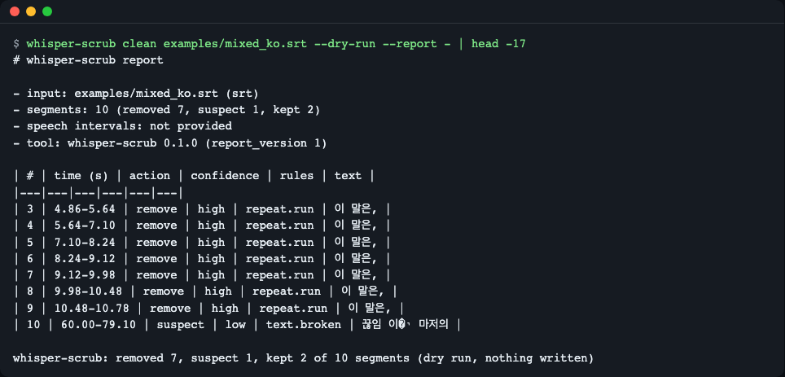
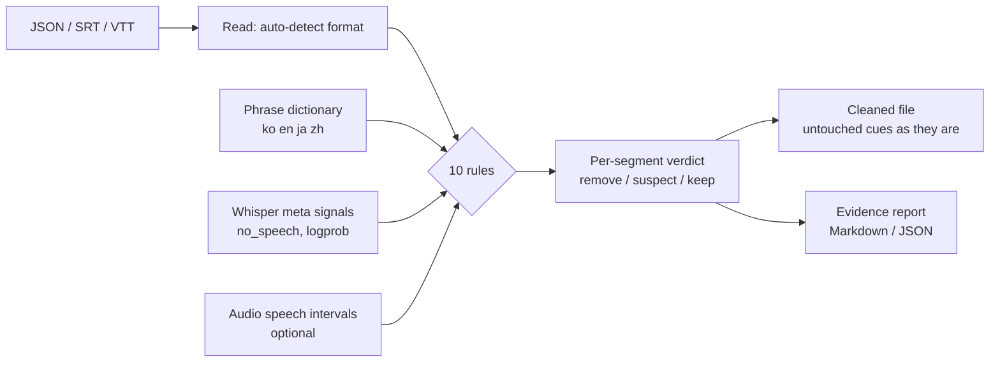
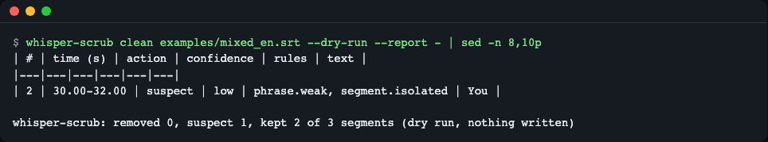
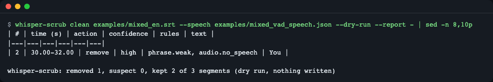
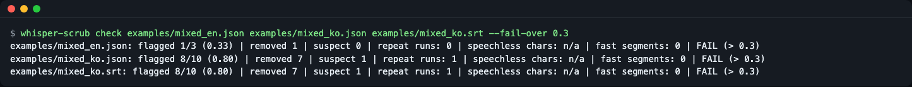

# whisper-scrub

**English** | [한국어](README.ko.md)

A small Python library and CLI that finds and removes Whisper hallucinations (phantom sentences on silence or noise such as `You`, and same-sentence repeat loops) from JSON, SRT and VTT transcripts made by openai-whisper, faster-whisper, whisper.cpp or the OpenAI API. It combines a phrase dictionary, repeat rules, Whisper's own signals and (optionally) audio, keeps timecodes and untouched cues byte-for-byte, and writes a per-segment evidence report on why each was removed. Even without a ground-truth transcript, `check` shows a file's share of suspected hallucinations. Install: `pip install "whisper-scrub[audio]"`, run: `whisper-scrub clean talk.srt --dry-run --report -`. The bundled examples are recorded real outputs ("mock" inputs, no model runs when you try them).

## What it does

Imagine a transcriber who writes "시청해 주셔서 감사합니다" ("Thank you for watching") every time the room goes quiet. What Whisper does in silent or noisy stretches is similar. These are sentences that actually came out of a reproduction run with the `tiny` model in this repository (silence, noise and plain-tone inputs).

| Language | Input | Sentence produced |
|---|---|---|
| ko | silence, noise, tone | `수고하셨습니다` ("good work today") |
| ja | silence | `ご視聴ありがとうございました` ("thank you for watching") |
| en | silence | `You` |

## Installation

```bash
pip install "whisper-scrub[audio]"
```

- Python 3.10 or later. The base install has 0 runtime dependencies. The `[audio]` extra adds only numpy, and it is needed only when you read audio files directly (`--audio`). If you will use only a speech-interval JSON (`--speech`) or meta signals, `pip install whisper-scrub` is enough.
- With uv: `uv add "whisper-scrub[audio]"`, or without installing, `uvx whisper-scrub --help`. (Install uv: `curl -LsSf https://astral.sh/uv/install.sh | sh`)
- Install from source: `pip install "git+https://github.com/LeeGyeongPil/whisper-scrub"`
- In a clean environment, the wheel was installed with `[audio]` and the examples below were confirmed to run (Python 3.12, numpy 2.5.4).

## Quick start

The repository's `examples/` holds files that record results the faster-whisper 1.2.1 `tiny` model actually produced. These are **practice mock inputs**: no model runs, and only the saved results are read. It works the same way on transcripts you made yourself.

You need uv (see the Installation section). To use it without uv, run `python -m venv .venv && .venv/bin/pip install -e ".[audio]"` and then run `.venv/bin/whisper-scrub` without `uv run`.

```bash
git clone https://github.com/LeeGyeongPil/whisper-scrub
cd whisper-scrub
uv sync
uv run whisper-scrub clean examples/mixed_ko.srt --dry-run --report -
```

`--dry-run` only judges and writes no files. `--report -` prints the report to the screen. This is how an 8-in-a-row "이 말은," ("this is,") loop, caused by forcing Korean (`language="ko"`) onto English speech, gets caught.



*Figure 1. Cues 3 to 9 are `remove` by the `repeat.run` rule (only the first "이 말은," is kept). Cue 10 has a broken character (U+FFFD), so it is `suspect`.*

Actual output (the table part):

```text
whisper-scrub: removed 7, suspect 1, kept 2 of 10 segments (dry run, nothing written)
# whisper-scrub report

- input: examples/mixed_ko.srt (srt)
- segments: 10 (removed 7, suspect 1, kept 2)
- speech intervals: not provided
- tool: whisper-scrub 0.1.0 (report_version 1)

| # | time (s) | action | confidence | rules | text |
|---|---|---|---|---|---|
| 3 | 4.86-5.64 | remove | high | repeat.run | 이 말은, |
| 4 | 5.64-7.10 | remove | high | repeat.run | 이 말은, |
| 5 | 7.10-8.24 | remove | high | repeat.run | 이 말은, |
| 6 | 8.24-9.12 | remove | high | repeat.run | 이 말은, |
| 7 | 9.12-9.98 | remove | high | repeat.run | 이 말은, |
| 8 | 9.98-10.48 | remove | high | repeat.run | 이 말은, |
| 9 | 10.48-10.78 | remove | high | repeat.run | 이 말은, |
| 10 | 60.00-79.10 | suspect | low | text.broken | 끊임 이�י 마저의 |
```

Below the report, each rule's evidence appears on one line. For example:

```text
- #3 remove: `repeat.run` value=copy 2 of 8 threshold=>= 3 in a row - same sentence as the previous segment; the first of 8 copies is kept
```

To actually write the cleaned file, use `-o` instead of `--dry-run`:

```bash
uv run whisper-scrub clean examples/mixed_ko.srt -o ko.clean.srt
```

```text
whisper-scrub: removed 7, suspect 1, kept 2 of 10 segments (wrote ko.clean.srt)
```

The only difference between the original and the cleaned file is that the cue blocks 3 to 9 are removed entirely. Blocks 1, 2 and 10 are byte-for-byte identical, and the numbers stay as they were (1, 2, 10) (with `--renumber` they become 1, 2, 3).

```text
9,36d8
< 3
< 00:00:04,860 --> 00:00:05,640
< 이 말은,
< 
< 4
< 00:00:05,640 --> 00:00:07,100
< 이 말은,
(…cues 5 to 9 look the same…)
```

## Core concepts



1. **It combines signals rather than deleting on one.** A `remove` happens when (a) a rule that is sufficient on its own fires (`phrase.strict`, `repeat.run`, `meta.silent_window`, etc.), or (b) a weak phrase match (`phrase.weak`) is accompanied by one more piece of evidence that "there is no speech" (`meta.no_speech` or `audio.no_speech`). If the evidence falls short, it stays as `suspect` (suspected, not deleted). If there is counter-evidence that speech is present, it is `keep`.
2. **Meta signals work per 30-second window.** Whisper's `no_speech_prob`, `avg_logprob` and compression ratio are computed per decoding window, not per segment. Segments in the same window share the same values, so meta alone cannot tell them apart. In the Korean example above, 9 segments shared the same values (no_speech 0.093, logprob -1.475, compression ratio 2.222). That is why `repeat.run`, which looks at the sentence repetition itself, is needed. The "Shared meta values" section of the report shows such groups.
3. **Whisper's own skip rule has a hole.** Whisper treats a stretch as silent and skips it only when `no_speech_prob > 0.6` **and** `avg_logprob` is `-1.0` or lower. In this repository's recording, 20 seconds of silence came out as `" You"`, and its values (no_speech 0.985, logprob -0.942) slipped through the second condition.
4. **`suspect` and `remove` differ.** Even when the phrase is the same, it may be real speech (a "Thank you." at the end of a meeting), so it deletes only when there is firm evidence.

### Rule table

| Rule ID | What it looks at | Deletes alone? | False-positive risk |
|---|---|---|---|
| `phrase.strict` | The normalized whole sentence equals a certain hallucination phrase in the dictionary (subtitle credits, etc.) | Yes | Low: only sentences that almost never appear in real speech are strict |
| `phrase.weak` | Equals a weak phrase in the dictionary ("You", "수고하셨습니다", etc.) | No, only together with other signals | High: it may be real speech, so it is not deleted alone |
| `repeat.run` | The same sentence 3 or more times in a row -> keep only the first | Yes | Medium: "네 네 네" ("yes yes yes") in real conversation |
| `repeat.loop` | Character or word repetition within one segment | No | Medium: songs, stuttering |
| `meta.no_speech` | `no_speech_prob` is 0.6 or more | No | Medium: it is a per-window value, so a normal sentence in the same window can also be high |
| `meta.silent_window` | no_speech >= 0.8 and logprob < -1.0 | Yes | Low: the same direction as Whisper's own skip condition |
| `audio.no_speech` | There is no speech in the audio under the segment | Yes if overlap is 0 and it is 1 second or longer (even a fluent sentence is seen as a hallucination). If the speech intervals cannot be trusted (see "Known limits" below), the rule itself is turned off | Depends on the quality of the interval file |
| `audio.beyond_end` | Deleted if the start is after the end of the audio. `suspect` if the end is more than 0.5 seconds past the audio length | Yes, only when the start is beyond | Low: when the length was given wrongly |
| `text.broken` | A broken character (U+FFFD) | No | Low |
| `segment.isolated` | A very short segment set apart from its neighbors | No (auxiliary signal) | High: used only as an aid |

All thresholds can be changed with `Config`. `strict` phrases are ones very unlikely to occur as real speech (subtitle production credits, etc.), while `weak` phrases are short ones that can come out either as hallucinations or as real speech.

## Usage

### Command line

```text
whisper-scrub clean   input  [-o output] [--report file|-] [--dry-run] [--renumber]
                          [--audio WAV | --speech JSON] [--phrases TSV] [--lang ko|en|ja|zh]
                          [--repeat-min N] [--phantom-min-seconds SEC] [--no-speech-guard] ...
whisper-scrub check   input...  [--fail-over ratio] [--audio-dir DIR] [--format table|json] ...
whisper-scrub phrases [--lang ko|en|ja|zh] [--phrases TSV] [--no-builtin]
```

The input format is auto-detected from the content: openai-whisper `result` JSON, OpenAI `verbose_json`, faster-whisper segment-list JSON, whisper.cpp `-oj` JSON, SRT, VTT. If it is unknown, you get `UnknownFormatError`. Tuning options: `--repeat-min N` (from how many consecutive repeats of the same sentence to collapse, default 3), `--phantom-min-seconds SEC` (the minimum length for deleting on `audio.no_speech` alone, default 1.0), `--no-speech-guard` (turn off the safeguard below, on by default). It never overwrites the input file (it is an error if `-o` equals the input). Exit codes: 0 normal, 1 `check --fail-over` exceeded, 2 usage error (a one-line message with how to fix it).

### When you have an audio signal

An SRT has no meta signals, so a subtitle with just a `You` line, like the one below, ends as `suspect`.

```bash
uv run whisper-scrub clean examples/mixed_en.srt --dry-run --report -
```

```text
| # | time (s) | action | confidence | rules | text |
|---|---|---|---|---|---|
| 2 | 30.00-32.00 | suspect | low | phrase.weak, segment.isolated | You |
```



*Figure 2. Without audio evidence, `You` only gets suspicion and is not deleted.*

If you give the speech intervals of the original audio (`[{"start": seconds, "end": seconds}]` JSON), the same line becomes `remove`.

```bash
uv run whisper-scrub clean examples/mixed_en.srt --speech examples/mixed_vad_speech.json --dry-run --report -
```

```text
| # | time (s) | action | confidence | rules | text |
|---|---|---|---|---|---|
| 2 | 30.00-32.00 | remove | high | phrase.weak, audio.no_speech | You |

- #2 remove: `phrase.weak` value=you threshold=exact - exact match of en dictionary phrase 'you' (weak, source: AGH:hallucination_list)
- #2 remove: `audio.no_speech` value=0.0 threshold=< 0.1 - no speech in the audio under this 2.0s segment (even a fluent sentence is a phantom)
```



*Figure 3. With the added evidence that there is no speech at 30-32 seconds, it is `remove`.*

**Safeguard.** If the speech intervals are empty, or do not overlap at all with 80% or more of the long segments that have text (3 or more), it concludes the interval file is wrong and skips the `audio.no_speech` rule that relies on speech intervals (`audio.beyond_end`, which relies on the audio length, still applies if you gave `--audio`). It also leaves a warning on stderr and in the report (a `WARNING` line, and the `warnings` key in JSON). This is the result with an empty interval file (`[]`) (`You` is not deleted and becomes `suspect`).

```bash
echo '[]' > empty.json
uv run whisper-scrub clean examples/mixed_en.srt --speech empty.json --dry-run --report -
```

```text
whisper-scrub: warning: speech intervals cover almost none of the transcript - check the file and its units (seconds) or the recording level; the audio rules were skipped, so nothing was deleted because of the audio
whisper-scrub: removed 0, suspect 1, kept 2 of 3 segments (dry run, nothing written)
# whisper-scrub report

- input: examples/mixed_en.srt (srt)
- segments: 3 (removed 0, suspect 1, kept 2)
- speech intervals: 0
- tool: whisper-scrub 0.1.0 (report_version 1)
- WARNING: speech intervals cover almost none of the transcript - check the file and its units (seconds) or the recording level; the audio rules were skipped, so nothing was deleted because of the audio

| # | time (s) | action | confidence | rules | text |
|---|---|---|---|---|---|
| 2 | 30.00-32.00 | suspect | low | phrase.weak, segment.isolated | You |
```

To give a WAV file (16-bit PCM) directly, use `--audio clip.wav` (the `[audio]` extra is required), and the speech intervals are found with a simple energy-based detector. It separates sound from silence but cannot separate speech from noise. Convert mp3 and the like first with `ffmpeg -i in.mp3 -ar 16000 -ac 1 -c:a pcm_s16le out.wav`. It also deletes a fluent sentence that is not in the dictionary when it sits over a silent stretch (`examples/audio_demo.py`, 2 seconds of sound + 3 seconds of silence made with numpy).

```bash
uv run python examples/audio_demo.py
```

```text
#1 keep    -  Today we start with the budget.
#2 remove  audio.no_speech  Please remember to like and subscribe to the channel.
```

### Quality check without ground truth: `check`

```bash
uv run whisper-scrub check examples/mixed_en.json examples/mixed_ko.json examples/mixed_ko.srt --fail-over 0.3
echo $?
```

```text
examples/mixed_en.json: flagged 1/3 (0.33) | removed 1 | suspect 0 | repeat runs: 0 | speechless chars: n/a | fast segments: 0 | FAIL (> 0.3)
examples/mixed_ko.json: flagged 8/10 (0.80) | removed 7 | suspect 1 | repeat runs: 1 | speechless chars: n/a | fast segments: 0 | FAIL (> 0.3)
examples/mixed_ko.srt: flagged 8/10 (0.80) | removed 7 | suspect 1 | repeat runs: 1 | speechless chars: n/a | fast segments: 0 | FAIL (> 0.3)
1
```

> Without `--fail-over`, there is no `FAIL` mark and the exit code is 0. If any file's ratio exceeds the threshold, the exit code is 1.



*Figure 4. The suspicion ratio per file (`removed+suspect` / segments). Use it in dataset cleaning to re-transcribe only the files with a high ratio.*

`flagged` is the remove+suspect ratio, `repeat runs` is the number of repeated stretches, `speechless chars` is the share of characters placed in stretches without speech (computed only when you give audio or speech intervals, otherwise `n/a`), and `fast segments` is the number of segments with an abnormally high number of characters per second.

### Python

You can feed the result of faster-whisper's `model.transcribe()` (a generator) or JSON segment dictionaries straight into `scrub()`. The parts that need a model were not run in this document, and the example below runs on a recorded faster-whisper result (`examples/mixed_en.json`). The path that accepts `Segment`-shaped objects is checked by a test (`tests/test_io.py`).

```python
import json
from pathlib import Path

from whisper_scrub import scrub

data = json.loads(Path("examples/mixed_en.json").read_text(encoding="utf-8"))
result = scrub(data["segments"], audio_duration=data["duration"])

for seg, verdict in zip(result.segments, result.verdicts):
    rules = ", ".join(h.rule_id for h in verdict.rules) or "-"
    print(f"#{seg.index} {seg.text.strip()[:30]!r:34} {verdict.action:8} {verdict.confidence:7} {rules}")
print("kept:", [s.index for s in result.kept])
```

(This is the same code as `examples/api_demo.py`, run with `uv run python examples/api_demo.py`.)

```text
#1 'And so my fellow Americans ask'   keep     none    -
#2 'You'                              remove   medium  phrase.weak, meta.no_speech
#3 'And so my fellow Americans ask'   keep     none    -
kept: [1, 3]
```

Here a meta signal (no_speech 0.985) is present, so `confidence` is `medium`. With audio added, it would be `high`.

### Your own phrase dictionary

To use your own phrases instead of the built-in dictionary, write one TSV line as `phrase<TAB>strict|weak` (weak if the grade is omitted). Lines starting with `#` are comments.

```text
# my phrases
subtitles by the amara org community	strict
please like and subscribe	weak
```

```bash
uv run whisper-scrub phrases --lang en --no-builtin --phrases my.tsv
```

```text
en	strict	subtitles by the amara org community	user
en	weak	please like and subscribe	user
```

Check the built-in dictionary:

```bash
uv run whisper-scrub phrases --lang ko
```

```text
ko	weak	수고하셨습니다	probe:raw_silence30_ko,raw_noise30_ko,raw_tones30_ko
```

The dictionary size is 30 for en (10 strict, 20 weak), 1 for ko, 2 for ja and 3 for zh. The English entries come from a public list (DSP-AGH Bag of Hallucinations, MIT), and the source is in [THIRD_PARTY_NOTICES.md](THIRD_PARTY_NOTICES.md). For ko, ja and zh, only outputs reproduced directly were included (the source column names the reproduction run). Partial matching is off by default (turn it on with `--substring`), and even when on, a weak phrase is deleted only with a second signal.

## API

| Name | What it does | Main arguments | Returns |
|---|---|---|---|
| `scrub(segments, *, audio_duration, speech, config)` | Judges a list of segments (dictionaries, `Segment`, `Document`) | `audio_duration` seconds, `speech` list of speech intervals, `config` | `ScrubResult` |
| `scrub_file(path, out, *, audio, speech, audio_duration, report, dry_run, renumber, config)` | Reads a file, judges it, and writes the cleaned file and report. Does not touch the input | `out` (required unless `dry_run=True`) | `ScrubResult` |
| `load(path)` / `loads(text)` | Reads a file / string with automatic format detection | | `Document` |
| `check_result(result)` | Computes quality metrics without ground truth | `ScrubResult` | `CheckReport` (`summary_line()`, `as_dict()`) |
| `Config(...)` | All thresholds (table below) | `ConfigError` if a value is out of range | `Config` |
| `PhraseBook.builtin()`, `.from_file(path)`, `.merge(other)` | Phrase dictionary | | `PhraseBook` |
| `ScrubResult` | `.segments`, `.verdicts`, `.kept`, `.removed`, `.suspects`, `.flagged_ratio`, `.report_markdown()`, `.report_json()` | | |
| `Verdict` / `RuleHit` / `Segment` | Verdict (`action`, `confidence`, `rules`) / rule evidence (`rule_id`, value, threshold) / segment (`index`, `start`, `end`, `text`, 4 optional meta fields) | | |
| Exceptions | Under `ScrubError`: `UnknownFormatError`, `ConfigError`, `MissingExtraError`, `AudioError` | | |

Main `Config` values (defaults): `no_speech_threshold=0.6`, `silent_no_speech=0.8`, `silent_logprob=-1.0`, `repeat_min=3`, `repeat_max_gap=10.0` (seconds), `loop_min=4`, `speech_overlap_min=0.1`, `phantom_min_seconds=1.0`, `guard_speech_intervals=True`, `speech_guard_ratio=0.8`, `beyond_end_slack=0.5`, `substring=False`, `lang=None` (guess the language from the characters).

Python code that uses your own dictionary:

```python
from whisper_scrub import Config, PhraseBook, scrub

book = PhraseBook.builtin().merge(PhraseBook.from_file("my.tsv"))
result = scrub(segments, config=Config(phrases=book, repeat_min=4))
```

(The snippet above is an excerpt that assumes `segments` already exists, and a test checks the same call path.)

## When to use it

- Use it when: you receive transcripts and subtitles that already exist (including SRTs you cannot run again) and want to clean up only the hallucinations. It also handles SRT and VTT with no meta signals. Also when you want to pick out "is this file suspicious?" without ground truth.
- Use another tool when: if you want to stop it at the transcription stage, use faster-whisper's `vad_filter` and `hallucination_silence_threshold` options, or the VAD options of [whisper.cpp](https://github.com/ggml-org/whisper.cpp). If you need a filter that works only from Whisper's meta signals (no_speech, logprob, compression ratio), use [whisper-guard](https://pypi.org/project/whisper-guard/). You can use it together with these tools (turn on the preventive options at transcription and clean up what remains afterward). Check each tool's documentation for what it does now.

## Known limits

- **The ko, ja and zh dictionaries are thin.** Only 1 Korean, 2 Japanese and 3 Chinese entries (the principle is to include only what was confirmed by reproduction). Most Korean phrases are caught not by the dictionary but by `repeat.run`, meta and audio signals. Put phrases you see in your own data into the user dictionary.
- **Speech intervals that are wrong only in part can still delete real speech.** A segment with 0 overlap and 1 second or longer is deleted alone by `audio.no_speech` even if the sentence is not in the dictionary. If the intervals are empty or do not overlap with most sentences, it warns and ignores them, but intervals that are off only in part are followed as they are. The energy detector cannot separate speech from loud noise. Look with `--dry-run` first. Change the 1-second criterion with `--phantom-min-seconds`.
- **For a recording that is silent throughout, the audio rules are turned off because of the safeguard.** A hallucination over a file with no speech at all cannot be caught by `audio.no_speech`. If the file really is like that, force it with `--no-speech-guard`.
- **The same sentence 3 or more times in a row is collapsed.** "네 네 네" in real conversation can be collapsed too. Adjust with `--repeat-min N` (in Python, `Config(repeat_min=...)`).
- Audio is read directly only as 16-bit PCM WAV. Convert other formats with ffmpeg first.
- There is not yet a real mode (a `[whisper]` extra that runs transcription as well in one go). All examples are recorded inputs.

## Troubleshooting

| Symptom | Cause | Fix |
|---|---|---|
| A single `You` line is not deleted and appears only as `suspect` | An SRT has no meta signals and there is no audio evidence | Give `--speech` (speech-interval JSON) or `--audio` |
| CLI: `whisper-scrub: error: numpy is required for --audio ...` (exit code 2), Python API: `MissingExtraError` | numpy is missing | `pip install "whisper-scrub[audio]"` |
| CLI: `whisper-scrub: error: cannot read <파일> as a WAV file ...`, Python API: `AudioError` | The input is not a WAV or not 16-bit | `ffmpeg -i in.mp3 -ar 16000 -ac 1 -c:a pcm_s16le out.wav` |
| `UnknownFormatError` | An unsupported JSON or subtitle format | Convert to a supported format (list above), or pass the segment list directly to `scrub()` |
| Exit code 2 | Usage error (arguments, file path, `-o` equal to the input, etc.) | Follow the guidance in the one-line message |
| A normal sentence comes out as `remove` | The speech-interval file is off in part, or the repeated sentence is real speech | Check the evidence in the `--dry-run` report and fix the interval file, or adjust `--repeat-min` and `--phantom-min-seconds` |
| `warning: speech intervals cover almost none of the transcript ...` | The interval file is empty, the units are not seconds, or the recording is too quiet | Check that `start` and `end` in the interval JSON are in seconds, and the recording level. If the file really is silent, `--no-speech-guard` |

(`<파일>` in the CLI message is the placeholder for "file".)

## Versions and compatibility

- Follows Semantic Versioning (SemVer). During 0.x, the API may change in minor versions, and changes are recorded in [CHANGELOG.md](CHANGELOG.md).
- Currently 0.1.0. Python 3.10 to 3.14 is declared as supported, and CI runs on 3.10 and 3.12 (ubuntu).

## Development and contributing

```bash
uv sync
uv run pytest -q
```

```text
106 passed, 1 skipped in 0.54s
```

The 1 skipped test is the test marked `real` that needs a real model (skipped if `WHISPER_SCRUB_MODEL_DIR` is not set). A contribution that adds a phrase to the dictionary must come with **the evidence of a reproduced run (model, input, output)**.

## Learn more

- The closest tool: [whisper-guard](https://pypi.org/project/whisper-guard/) — meta-signal thresholds and a repeat filter.
- English hallucination phrase list: DSP-AGH Bag of Hallucinations (MIT); for the detailed source, see [THIRD_PARTY_NOTICES.md](THIRD_PARTY_NOTICES.md).
- Skip rule of the original Whisper implementation: `transcribe.py` in [openai/whisper](https://github.com/openai/whisper).
- Description of the recorded inputs: [examples/README.md](examples/README.md).

## License

MIT. For third-party notices, see [THIRD_PARTY_NOTICES.md](THIRD_PARTY_NOTICES.md).
